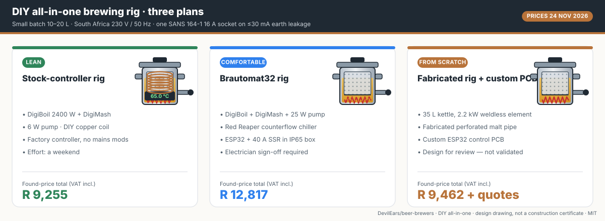
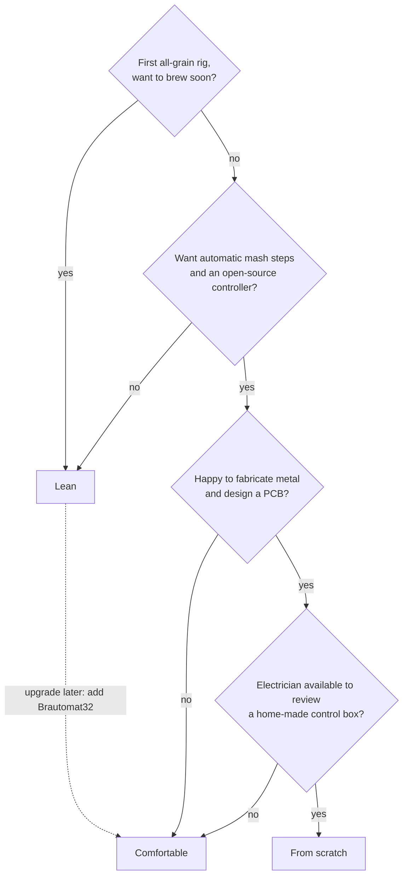

# DIY electric all-in-one brewing rig

    

This folder holds three ways to build a Grainfather-style **single-vessel recirculating mash** system for **10–20 L batches** in South Africa. All three run on one **SANS 164-1 16 A** socket at **230 V / 50 Hz**. They range from "buy the parts and plug them in" to "fabricate the vessel and design your own control board".

> [!WARNING]
> These are design documents, not wiring certificates. Every plan has a South African electrical safety section (RCD, earthing, SANS 10142-1). **Any mains work you build must be checked and signed off by a licensed electrician before first use.** Nothing here has been bought, built or tested.

## The three plans

| | [**Lean**](lean/spec.md) | [**Comfortable**](comfortable/spec.md) | [**From scratch**](from-scratch/spec.md) |
|---|---|---|---|
| **Idea** | Factory DigiBoil and its own controller, plus a malt pipe and pump | Same kettle, run by Brautomat32 on an ESP32 with an SSR | Plain kettle, fabricated malt pipe, custom ESP32 PCB |
| **Found-price total (inc VAT)** | **R 9,255.10** (8 lines) | **R 12,817.12** (18 lines) | **R 9,461.56** (27 lines) **+ element, sheet, PCB** |
| **Unpriced extras** | Chiller water hose; RCD plug and outlet | Mains cabling and plug; chiller hook-up; 12 V fan PSU | 2.2 kW element (no SA stockist found), perforated sheet, fasteners, MCB/PE bar, PCB fabrication |
| **Element** | 2400 W, concealed (factory) | 2400 W, concealed, switched by a 40 A SSR | 2200 W weldless, 32 mm hole |
| **Controller** | DigiBoil display, manual steps | Brautomat32, automatic steps, Wi-Fi | Brautomat32 on a custom PCB |
| **Chiller** | DIY copper immersion coil | Red Reaper counterflow | DIY copper immersion coil |
| **Effort** | Low | Medium | High |
| **Skills** | Hose clamps, bending copper | Soldering, flashing firmware | Sheet metal, punching stainless, KiCad, soldering |
| **Time to first brew** | One weekend | 2–3 evenings + electrician + a water day | 4–6 weekends + fabrication lead times |
| **Mains work** | RCD lead only (electrician) | Element switching (electrician) | Whole control box and element (electrician) |
| **Status** | Ready to buy after review | Ready to buy after review | **Design for review, not validated** |
| **Pros** | Cheapest, safest, nothing opened | Automatic mash, open-source control, upgradeable | Fully open hardware, best learning, most repairable |
| **Cons** | Manual steps; factory controller only | Costs more than a BrewZilla; needs an electrician | Most risk and work; element not yet sourced in SA |

**Make vs buy:** a complete BrewZilla 35 L Gen 4.1, now listed with a free immersion chiller, was **R 11,150** at [Beyond Brewing](https://beyondbrewing.co.za/product/brewzilla-35l-gen-4-with-free-immersion-chiller/) on 24 Nov 2026. Grainfather G30 was R 17,965 at [Brewcraft](https://www.brewcraft.co.za/products/g30-grainfather-connect-sa).

## Which plan should I pick?

**Upgrade path:** lean and comfortable share the same kettle and malt pipe. Starting lean and adding the Brautomat32 box later wastes very little. The 6 W pump would need to become a 25 W pump only if you want faster recirculation.

## What's in this folder

| Path | What |
|---|---|
| [`lean/spec.md`](lean/spec.md) · [`bom.csv`](lean/bom.csv) · [`shopping-list.md`](lean/shopping-list.md) | Lean plan |
| [`comfortable/spec.md`](comfortable/spec.md) · [`bom.csv`](comfortable/bom.csv) · [`shopping-list.md`](comfortable/shopping-list.md) | Comfortable plan (the first design brief, polished) |
| [`from-scratch/spec.md`](from-scratch/spec.md) · [`bom.csv`](from-scratch/bom.csv) · [`shopping-list.md`](from-scratch/shopping-list.md) | From-scratch design: vessel, malt pipe, PCB, enclosure, test plan |
| [`assets/`](assets/) | SVG drawings (render on GitHub): [hero](assets/hero-plans.svg), [lean layout](assets/lean-system.svg), [comfortable wiring](assets/comfortable-wiring.svg), [vessel exploded view](assets/from-scratch-vessel-exploded.svg), [flat patterns + coil](assets/from-scratch-malt-pipe-pattern.svg), [enclosure layout](assets/from-scratch-enclosure-layout.svg), [PCB block diagram](assets/from-scratch-pcb-block.svg) |

## How prices are recorded

- Every price comes from a shop page or that shop's product feed, read on **24 November 2026 (Africa/Johannesburg, SAST)**. The URL is in each `bom.csv`.
- Prices include VAT. Communica's feed gives prices ex VAT; those are converted at × 1.15 and checked against a product page.
- **If a price could not be confirmed, the cell is blank**, not estimated. Totals add up found prices only.
- Shipping and electrician labour are never included.
- Each `bom.csv` uses the same columns: `part, spec, qty, example_sa_supplier_url, price_zar_inc_vat, price_observed, stock_when_observed, tier, notes`. `tier` marks the plan, or `alternative` / `reference` rows that are not in the total.

## Colour key used in the drawings

| Colour | Meaning |
|---|---|
| Red | 230 V mains |
| Purple | Low voltage (5 V / 3.3 V) |
| Green / yellow dashed | Protective earth |
| Amber | Wort path |
| Blue | Cooling water |
| Copper | Copper tube |
