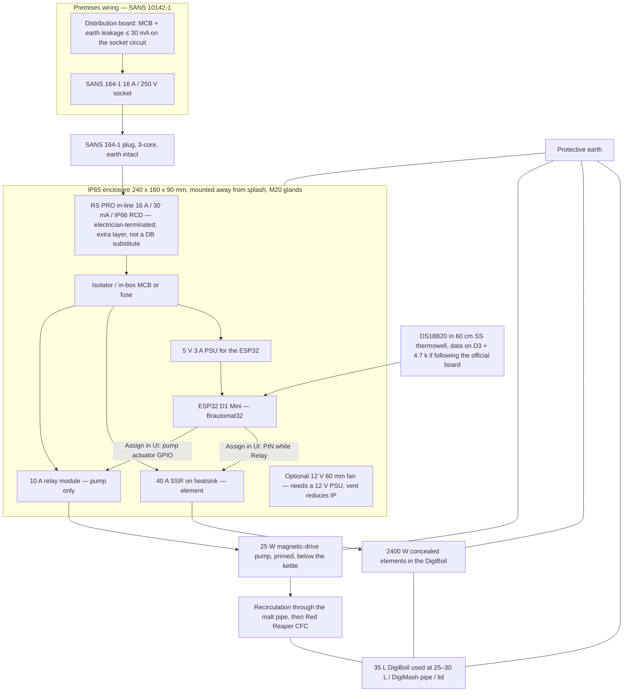

# DIY electric all-in-one brewing system — design brief

**Status:** research and design only. Nothing has been purchased, wired, or written to GitHub.  
**Audience:** Devilliers, South Africa (230 V / 50 Hz). Starting from scratch; first target is a **small batch**, about **10–20 L into the fermenter**.  
**Chosen path (comfortable DIY):** 35 L DigiBoil 2400 W + DigiMash malt-pipe kit + 25 W magnetic pump + Red Reaper counterflow chiller + camlocks/valve + **Brautomat32** on an ESP32 D1 Mini, in an IP65 box, with an in-line 16 A / 30 mA RCD.  
**Price date:** listed South African rand prices were read from shop pages on **24 November 2026, Africa/Johannesburg (SAST, UTC+2)**. Prices include VAT where the shop marked them “VAT Incl.”, “Tax included”, or “Inc Tax”. Shipping is not included. **If a price could not be confirmed, it is left blank — not guessed.**  
**Safety:** this is not a wiring or installation certificate. Mains work should be reviewed and signed off by a licensed electrician before first use.

The full parts list is in [`bom.csv`](bom.csv) (includes a `tier` column). The comfortable shopping list, grouped by supplier, is in [`shopping-list.md`](shopping-list.md).

---

## 1. What we are building

A Grainfather / Brewzilla / Guten-style **single-vessel recirculating mash**: one kettle with an electric element, a malt pipe, a pump that recirculates wort through the grain bed, temperature control, and a counterflow chiller.

Commercial references in §2 ground **capacity, element wattage, and pump** targets. The chosen DIY path is not a clone of any one brand.

---

## 2. Commercial reference specs

Figures are from manufacturer or retailer pages cited in the table. Where two official sources disagree, both are shown.

| System | Working / batch volume | Vessel / pre-boil | Element (230 V class) | Pump | Grain bill (as published) | Sources |
|---|---|---|---|---|---|---|
| **Grainfather G30** | Max batch **25 L**, min **10 L** (micro pipework may be required for the min, per one Grainfather sheet) | Max pre-boil **30 L** | **2000 W, 230 V** (US 120 V model is 1600 W — not the SA target) | **6 W** magnetic drive; one compare page lists max flow **11 L/min** at 230 V / 50 Hz | Compare page: **1.5–8 kg**, or **9 kg** with optional top plate. An older G30 sheet also lists max **9 kg** and min **5 kg**. Treat the range as source-dependent. | [Grainfather compare](https://us.grainfather.com/pages/compare-the-grainfather-brewing-systems); [G30 vs G40 vs G70](https://help.grainfather.com/hc/en-us/articles/49893025922449-What-are-the-differences-between-the-Grainfather-G30-G40-G70); [G-series sheet](https://help.grainfather.com/hc/en-us/article_attachments/4423129216913) |
| **Grainfather G40** | Max batch **40 L**, min **10 L** | Max pre-boil **46 L** | EU/US: **3300 W, 230 V**; NZ/AU also **2300 W (10 A) / 3300 W (15 A)**; UK **2900 W**. Tech sheet lists a **3150 W** aluminium bolted element. 15 A mode in NZ/AU needs a dedicated 15 A socket and extra cable. **This is above the 16 A-plug target for this brief.** | **22/25 W**, max flow **16/19 L/min**, 230 V, 50/60 Hz, heat rating 105 °C | Max **13 kg**, min **3 kg** (tech sheet). An older marketing sheet said max 12 kg. | [G40 tech sheet](https://help.grainfather.com/hc/en-us/article_attachments/8895650938257); [compare page](https://us.grainfather.com/pages/compare-the-grainfather-brewing-systems) |
| **Brewzilla 35 L** (Gen 4 / 4.1, 220–240 V) | Retailers describe batches **up to 30 L** and a finished output around **5–6 US gallons**. Total capacity is described as **9.25 US gallons / 35 L**. | Use ~25–30 L in the kettle so there is boil headspace (see also the DigiBoil note below). | Dual elements **1900 W + 500 W = 2400 W** on the 220–240 V model. | Gen 3.x replacement pump sold in SA: **6 W**, **220–240 V**, max flow **12 L/min** at 240 V (the comfortable build instead uses a **25 W** MKII pump, 19 L/min, 3.4 m head, 120 °C). | One US Gen 4 listing: recommended max **23.5 lb**. Another: mash up to **20 lb**. Not independently reconciled. | [Brewhardware 220 V Gen 4](https://www.brewhardware.com/product_p/brewzilla35_220v.htm); [Beyond Brewing 25 W pump](https://beyondbrewing.co.za/product/magnetic-drive-pump-mkii-version-25-watt/); [Beyond Brewing Gen 4.1 35 L](https://beyondbrewing.co.za/product/brewzilla-35l-gen-4-with-free-immersion-chiller/) |
| **Guten 40 L** “Nano-Brewery” | Retailer: **30 L** usable, **40 L** to the water line; described as suited to a **23 L** batch | 40 L to the line | **100–2500 W** adjustable in 100 W steps, **220–240 V, 50 Hz** | Integrated magnetic-drive pump, can be run separately | Malt pipe “holds up to **8 kg**” | [Storm Brewing Guten 40 L](https://www.stormbrewing.com.au/product-page/guten-40l-nano-brewery-system) |

**Targets for this comfortable build:** 10–20 L into the fermenter; 35 L DigiBoil used at **25–30 L** working volume ([Beyond Brewing](https://beyondbrewing.co.za/product/35l-digiboil-digital-turbo-boiler-2400watt/)); **2400 W** / shop rating **240 V / 10 A** on a standard SANS 164-1 16 A plug; 25 W high-temp magnetic pump; malt pipe (DigiMash, max 8 kg); counterflow chiller.

**South African street prices for complete commercial units** (reference only, 24 Nov 2026): Brewzilla 35 L Gen 4.1 **R 11,150** ([Beyond Brewing](https://beyondbrewing.co.za/product/brewzilla-35l-gen-4-with-free-immersion-chiller/)); Grainfather G30 **R 17,965** ([Brewcraft](https://www.brewcraft.co.za/products/g30-grainfather-connect-sa)); Grainfather G40 **R 29,235** ([Brewcraft](https://www.brewcraft.co.za/products/g40-grainfather)).

---

## 3. Architecture (chosen)

| Option | Verdict for this brief |
|---|---|
| **A. Kettle + malt pipe + pump (AIO)** | **Chosen.** 35 L DigiBoil + DigiMash + 25 W pump + CFC. |
| B. Same kettle, BIAB instead of a pipe | Not chosen. DigiMash kit is available. |
| C. RIMS / D. HERMS | Not the first build. |
| E. Buy a complete 35 L AIO | Fair alternative at R 11,150, but not the chosen DIY path. |

---

## 4. Controller (chosen: Brautomat32)

| Controller | Licence | Last activity (SAST, checked 24 Nov 2026) | Fit |
|---|---|---|---|
| **[Brautomat32](https://github.com/InnuendoPi/Brautomat32)** | **MIT** | Commit **24 Nov 2026, 20:11 SAST** | **Chosen.** Docs: [GitBook](https://innuendopi.gitbook.io/brautomat32/). Described as a controller for **ESP32 D1 mini** systems. |
| [CraftBeerPi 4](https://github.com/PiBrewing/craftbeerpi4) (PiBrewing fork) | GPL-3.0 | Commit 13 Sep 2026 | Fallback if a Pi ecosystem is preferred. |
| [Brick-32](https://github.com/BernhardSchlegel/Brick-32) | GPL-3.0 | 6 Aug 2025 | Easy, cloud-tied. |
| [BrewPiLess](https://github.com/vitotai/BrewPiLess) | No licence file found | 24 Apr 2025 | Not confirmed OSS; weak as a mash controller. |
| [esp-brew-engine](https://github.com/jeroen79/esp-brew-engine) | Custom: no redistribution of modifications | 28 Aug 2026 | Poor fit for an OSS project. |
| REX-C100 / Inkbird ITC-100 class | Closed commercial | Current product | Spare / baseline PID only. The ITC-308 is on/off, not a kettle PID. |

The official Brautomat **breakout PCB** was not found for sale in South Africa. The comfortable build uses a [BMT D1 Mini ESP32](https://www.communica.co.za/products/bmt-d1-mini-esp-32-dev-board) (R 135 inc VAT, in stock on 24 Nov 2026), which the seller describes as having the Wemos D1 Mini footprint and pin-outs, plus a dual-core ESP32. Confirm current firmware board support before flashing. Wiring still follows the published docs below, not a guessed pin map.

---

## 5. Electrical safety (South Africa, 230 V / 50 Hz)

Guidance for discussion with a licensed electrician. It does not replace **SANS 10142-1**, the Electrical Installation Regulations, or a CoC. SANS 10142-1 governs **premises wiring**, not “is this homemade appliance a certified product”.

### Current on a 16 A plug

A standard general-purpose plug/socket in South Africa is **SANS 164-1, 16 A, 250 V~** ([SAFEhouse sockets guide](https://safehousesa.co.za/guide-sockets/)).

At 230 V, **2400 W ≈ 10.4 A** (10.0 A at 240 V). That matches the DigiBoil page’s “240 V / 10 A” rating and still has headroom on a 16 A plug once a 25 W pump (~1.1 A per the pump page, if that figure is accurate) is added. Confirm the socket circuit’s breaker and earth leakage before brew day. Do not share the trailing socket with other heavy loads.

### Earth leakage / RCD

SAFEhouse: all socket outlets are to be protected by sensitive earth leakage with a nominal tripping current of **30 mA** ([guide](https://safehousesa.co.za/guide-sockets/)). A field summary of **SANS 10142-1:2026 (Edition 3.3)** states that in a new installation, circuits supplying SANS 164-1 or 164-2 sockets must have **non-auto-reclosing** earth-leakage protection, rated **not more than 30 mA** ([Elite Energy](https://www.eliteenergy.co.za/blog/articles/stove-circuit-earth-leakage-sans-10142-1.html), citing 6.7.5). Always check the current SABS text.

The comfortable BOM includes an **RS PRO in-line 16 A, 30 mA, IP66 RCD** at **R 964.10** inc VAT ([product](https://za.rs-online.com/web/p/rcd-plugs/2818923/)): 2-pole, 30 ms trip, rewireable, no cord included, for 7.5–10 mm cable. RS marked the price as indicative. A licensed electrician must terminate it with a **SANS 164-1** plug and connector. It is an **extra** layer, not a substitute for the distribution-board earth-leakage device or for a CoC if fixed wiring is changed. **No South African 3-pin plug-in 30 mA adaptor** with a confirmed price was found. Schuko (Type F) PRCDs sold in SA do not plug into a SANS 164-1 socket.

### Earthing, water, SSR, enclosure

- Protective earth must be continuous to the **kettle body**, **element earth**, **pump**, and **metal or bonded enclosure parts**. Do not defeat the earth pin.
- **Never dry-fire** the element. The 25 W pump must be **primed** and must **not run dry**.
- If the RCD trips more than once, **stop**, isolate, and have the appliance checked. Do not bypass it.
- A 40 A SSR switching ~10 A still needs its **heatsink**, thermal compound, and a thermal plan. The kit heatsink is about **81 mm** tall; the chosen IP65 box is **90 mm** deep — tight.
- Chosen enclosure: [ENL241610P](https://www.communica.co.za/products/enl241610p), **240 × 160 × 90 mm, IP65**, **R 362.25**, in stock. A 12 V 60 mm fan is listed as optional cooling, but it needs a **12 V PSU** (price not found) and a vent or cut-out that will **reduce IP65** unless designed. Mount the box away from splash.

Any new circuit, isolator, or interception of the DigiBoil element for an SSR must be **signed off by a licensed electrician**. Prefer LOA / reputable certification on plugs and leads ([SAFEhouse](https://safehousesa.co.za/guide-sockets/)).

---

## 6. Brautomat32 wiring plan (from the published docs)

This is a **logical** plan for a relay/SSR kettle, not a construction drawing. Conductor sizes, protective-device ratings, and terminations are for the electrician. Pin names such as `D3` are the **Wemos / official-board labels** used in the docs, not “any ESP32 GPIO number”.

**What the docs actually fix vs what you assign in software:**

| Function | Official / documented connection | Source |
|---|---|---|
| DS18B20 (up to three) | On the official board, **GPIO D3** has a **4.7 kΩ** pull-up and is intended for Dallas DS18B20 sensors. Ports are labelled `DS18B20-1` to `DS18B20-3` (Vcc / Data / GND). Typical colours: Vcc green or red, Data white or yellow, GND brown or black (cheap probes may vary). | [The board](https://innuendopi.gitbook.io/brautomat32/plat); [Ports](https://innuendopi.gitbook.io/brautomat32/plat/anschluesse) |
| Piezo buzzer (optional) | Official board: **GPIO D8** | [The board](https://innuendopi.gitbook.io/brautomat32/plat) |
| Kettle heater via SSR | **Not a single mandatory GPIO.** In *Set up relay kettle*, Device type = **Relay**, and **“PIN white [Relay]” is set to the output that is actually wired.** Changing that pin stops temperature control and switches the previous output off. | [Set up relay kettle](https://innuendopi.gitbook.io/brautomat32/info-1/relay-kettle); [Kettle configuration](https://innuendopi.gitbook.io/brautomat32/kessel) |
| Pump / other actuators | Configured by **name + GPIO** in the Actuators UI. GPIOs already assigned to kettles, sensors, or system functions **cannot** also be assigned to an actuator. An API example payload showed an agitator on `D0` and a pump on `D11` — that is an example of a *configured* device, not a required default. `D11` is also MOSI for PT100 (see below), so do not copy that example if a MAX31865 is fitted. | [Actuators](https://innuendopi.gitbook.io/brautomat32/act); [API example](https://innuendopi.gitbook.io/brautomat32/api) |
| SSR electrical interface | “Brautomat can switch SSRs directly. SSRs switch a 230 V AC load using a **3–5 V DC** control signal from Brautomat.” Example cited in the docs: Fotek SSR-40DA. Pumps may instead use a relay board. | [Hardware](https://innuendopi.gitbook.io/brautomat32/hw) |
| Power | External **5 V DC** supply is allowed. If powering from a GGM IDS, do not also connect an external supply (not used on this build). | [Ports](https://innuendopi.gitbook.io/brautomat32/plat/anschluesse) |
| PT100 via MAX31865 (optional, not in the first comfortable kit) | SCLK **D9**, MISO **D10**, MOSI **D11**, CS0 **D13**, CS1 **D16**, CS2 **D17**, Vin **3V3**, GND. Docs say DS18B20 is easier and is recommended. | [Ports](https://innuendopi.gitbook.io/brautomat32/plat/anschluesse); [Sensors](https://innuendopi.gitbook.io/brautomat32/info-5) |
| Nextion display / GGM IDS | Documented (display D1/D2; GGM command D6, relay D7) but **not used** on this first comfortable build. | [Ports](https://innuendopi.gitbook.io/brautomat32/plat/anschluesse) |

**Practical assignment for this build** (DS18B20 only, no GGM, no Nextion, no PT100): wire the DS18B20 data line as the official board does (**D3** + 4.7 kΩ to Vcc) if the D1 Mini pin labelled D3 is used; wire the **element SSR** input to one free GPIO and set that exact pin under “PIN white [Relay]”; wire the **pump relay** coil/input to a different free GPIO and assign it as a pump actuator. Recheck the current docs and the board silkscreen before soldering. Digital PWM for an SSR uses a 5000 ms cycle in 5% steps ([Actuators](https://innuendopi.gitbook.io/brautomat32/act)).

Probe mounting: insert the 6 mm DS18B20 into the **60 cm 304 SS thermowell** (7 mm ID) through the lid, and keep the **PVC cable** on the cool side of the lid. The kit seller warns that although the chip is rated to 125 °C, the **cable should stay under 100 °C**.

Docs also require a water test and AutoTune before a brew day ([Set up relay kettle](https://innuendopi.gitbook.io/brautomat32/info-1/relay-kettle)): sensor must already read plausibly; a shutdown must be reachable; first test is with water, under supervision.

---

## 7. Wiring block diagram

Logical layout only.

---

## 8. Bill of materials — comfortable total

Full rows, including lean/reference lines, are in [`bom.csv`](bom.csv). The `tier` column marks `comfortable`, `lean`, or `reference`.

**Comfortable DIY, found prices only (24 Nov 2026, Africa/Johannesburg):**

**R 12,807.72** VAT incl. across **18 priced lines** (camlocks and glands counted at qty × unit price).

That total **includes** the 2-channel pump relay at R 50.60, which was **out of stock** at both Micro Robotics warehouses. If that line is dropped until stock returns, the remaining found-price subtotal is **R 12,757.12**.

**Still unpriced (2 comfortable lines):**

1. Mains cabling, SANS 164-1 plug, ferrules, terminals, 4.7 kΩ pull-up, thermal compound, and a **12 V PSU for the fan**.
2. A complete **Red Reaper hook-up** from 9.5 mm duotight-compatible ports to 12.5 mm brew hose (the chiller does not include push-in fittings; a R 35 9.5 mm joiner is not a complete adapter kit).

Also not in the total: shipping, electrician labour, and official Brautomat PCB (not found in SA).

**Make vs buy:** a complete Brewzilla 35 L Gen 4.1 was **R 11,150**. The comfortable DIY *found-price* subtotal is already higher, and the two unpriced groups plus labour still sit on top. DIY is for the open-source controller and a documented build, not because it is cheaper.

---

## 9. Step-by-step build phases

1. **Water test with the stock DigiBoil controller (do this first, before opening the element wiring).**  
   Place the boiler on a sound 16 A socket that is already on 30 mA earth leakage. Fill with water to a normal working level (25–30 L max working, element fully covered). Heat with the **factory** controller only. Confirm the unit heats, the pump (once fitted and primed) circulates, there are no leaks, and the earth-leakage device does not nuisance-trip. Do not run the pump dry. Stop if anything smells, trips, or leaks.

2. **Low-voltage enclosure build (no mains into the new box yet).**  
   Flash Brautomat32 to the D1 Mini ESP32. Wire the DS18B20 (D3 + 4.7 kΩ if following the official board), 5 V PSU, and the **control** side of the SSR and pump relay. Confirm the web UI, a plausible temperature from the probe in the thermowell (in a mug of hot water is enough), and that the chosen GPIOs toggle the SSR LED / relay click. Set “PIN white [Relay]” and the pump actuator to the pins you actually used. Do not connect 230 V.

3. **Electrician sign-off (mandatory before any SSR-switched heat).**  
   The electrician terminates the in-line 16 A / 30 mA RCD with a SANS 164-1 plug and connector, earth-bonds the kettle, element, pump and enclosure, sizes the flex, fits glands, mounts the 40 A SSR and heatsink so they can cool in the 90 mm box, and signs off (and issues a CoC if any premises wiring changed). Intercepting the DigiBoil element is premises/appliance mains work — not a first-time DIY live job.

4. **Wet test with Brautomat32 (water only, under supervision).**  
   Follow [Set up relay kettle](https://innuendopi.gitbook.io/brautomat32/info-1/relay-kettle): sensor reads plausibly; shutdown is reachable; short heating test; **verify the heater switches off** from the power button. Then AutoTune with a typical water fill and the relay/SSR noise band of `0.5` as the docs suggest. Test pump start/stop, recirc, and a cold-water CFC hook-up (after a water “sanitise” recirc through the chiller, as you would on brew day). If switching is unexpected, temperature is implausible, or heat does not switch off: **stop immediately**.

5. **First brew.**  
   A straightforward 10–20 L recipe, well inside the 8 kg malt-pipe rating. Stay with the system. Use the pre-brew checklist below. Recirculate the last 15 minutes of the boil through the Red Reaper before applying cooling water, as the vendor recommends. Pitch into the fermenter only after a sane knockout temperature.

6. **Document.**  
   Photos, as-built pin list, electrician notes, and a later pull request into the hardware resource. **Not done in this pass.**

---

## 10. Pre-brew safety checklist

Walk this list before every heat-up, especially the first brew.

- [ ] Socket is SANS 164-1, in good condition, and on a working **≤30 mA** distribution-board earth-leakage device (use the DB test button, and/or a socket tester).
- [ ] In-line 16 A / 30 mA RCD is in circuit; operate its **test button** and confirm it trips, then reset.
- [ ] Earth pin intact; no cheater plugs or two-core leads. Visual check of earth bonds on kettle, element, pump, and enclosure.
- [ ] Licensed electrician has already signed off any SSR / element / enclosure mains work.
- [ ] Isolator or plug is **reachable** without reaching over the kettle.
- [ ] Element is fully covered with water or wort; you will **not** dry-fire.
- [ ] Pump is primed, below the liquid level, not running dry; discharge valve set so flow will not compact the mash violently.
- [ ] Lids, camlocks, and CFC connections are tight; hose is food-grade silicone, not on mains water pressure.
- [ ] Probe is in the thermowell; Brautomat32 shows a **plausible** temperature before heat is applied.
- [ ] You have already seen the **heater switch off** from the software power control on a water test.
- [ ] SSR heatsink is mounted, not loose, and has a path for heat (do not run a sealed box that is already hot to the touch).
- [ ] Floor is dry; no wet hands; drinks and hoses are off the control box; box is away from the tap and steam.
- [ ] If an RCD trips more than once: **stop**, isolate, do not reset-and-ignore, and have the system checked.
- [ ] Someone is present for the first heats; a fire blanket / extinguisher suitable for electrical fires is not a substitute for isolation, but know how you will cut power.
- [ ] After the boil: sanitise the CFC by recirculating hot wort, **then** apply cooling water; do not send boiling wort into a closed dry chiller or put acidic cleaner into the copper for storage (vendor warnings).

---

## 11. Open questions for Devilliers

1. Accept the **60 cm lid thermowell** (fermenter-style, 8 mm hole) or prefer a short 1/2 NPT side-wall well (50 mm, thread standard and fit not verified on the DigiBoil)?
2. The pump **relay module is out of stock**. Wait, or ask the electrician to fit a 10 A mains relay / second SSR?
3. Fit the **12 V fan** (needs an unpriced 12 V PSU and a vent that affects IP65) or rely on the heatsink in a larger/open thermal plan?
4. Who supplies the **9.5 mm CFC hook-up** to 12.5 mm brew hose? Beyond Brewing may be able to kit this; it is not priced here.
5. Budget: found-price subtotal is **R 12,807.72** plus unpriced parts and electrician, versus **R 11,150** for a complete Brewzilla 35 L. Still happy to DIY?
6. Brew site, and is that socket already on working 30 mA earth leakage?
7. Electrician available for sign-off before the first SSR heat?
8. Still outstanding for the repo: **where** this lives and **which licence**. No commits or PRs until you say so.

---

## 12. Unverified, conflicting, or missing items

- **Silicone hose price — resolved.** On 24 Nov 2026 the 6 m 12.5 mm roll’s own visible price and schema.org offer both read **R 725.00 VAT incl.**, in stock. An earlier pass had also seen R 580 / R 705 in other page widgets; those are not used.
- **Pump relay** priced at R 50.60 but **out of stock** at both Micro Robotics warehouses. No priced in-stock alternative found the same day.
- **12 V PSU** for the 60 mm fan: price not found. The fan page lists current as **0.06 mA**, which is almost certainly a typo and is not used as a design figure.
- **CFC 9.5 mm hook-up** to 12.5 mm hose: incomplete; joiner at R 35 is not sufficient on its own.
- **Official Brautomat PCB** not found in SA shops. D1 Mini ESP32 compatibility with the *current* firmware image should be confirmed before purchase.
- D1 Mini page does not state whether the USB connector is USB-C or Micro-USB; the 5 V 3 A USB-C PSU may need a cable/adapter.
- 60 cm thermowell is sold for **fermenter lids**; DigiBoil lid fit, steam, and an 8 mm hole were not physically checked. 50 mm well is 1/2 **NPT**, not confirmed as BSP, and is short.
- Enclosure **90 mm** depth vs **~81 mm** heatsink is tight; adding a fan cut-out changes the IP rating.
- RS RCD price is marked **indicative**; much of the “in stock” qty is “ready to ship from another location” (possible lead time).
- DigiMash marketing copy still says both “1500 W” and **1900 + 500 = 2400 W**; 2400 W / 10 A is used.
- G30 grain-bill figures and some Brewzilla max-grain figures still disagree across sources.
- Stock and prices will move.

---

## 13. Source index (primary)

- Brautomat32: [home](https://innuendopi.gitbook.io/brautomat32/), [board](https://innuendopi.gitbook.io/brautomat32/plat), [ports](https://innuendopi.gitbook.io/brautomat32/plat/anschluesse), [relay kettle](https://innuendopi.gitbook.io/brautomat32/info-1/relay-kettle), [actuators](https://innuendopi.gitbook.io/brautomat32/act), [hardware](https://innuendopi.gitbook.io/brautomat32/hw), [GitHub](https://github.com/InnuendoPi/Brautomat32)
- DigiBoil / DigiMash / pump / CFC: Beyond Brewing links in `bom.csv`
- Safety: [SAFEhouse sockets](https://safehousesa.co.za/guide-sockets/), [Elite Energy on SANS 10142-1](https://www.eliteenergy.co.za/blog/articles/stove-circuit-earth-leakage-sans-10142-1.html), [RS PRO in-line RCD](https://za.rs-online.com/web/p/rcd-plugs/2818923/)
