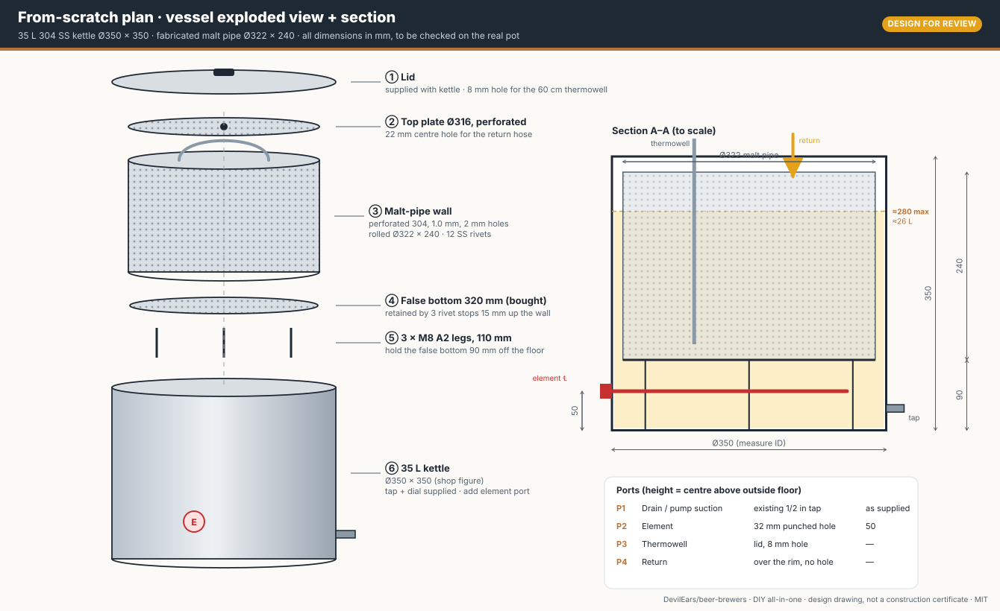
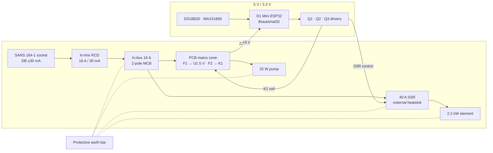
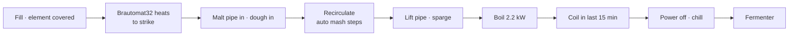
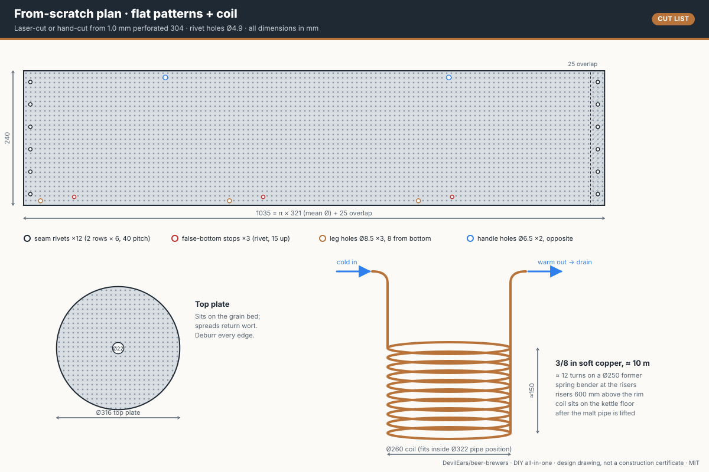
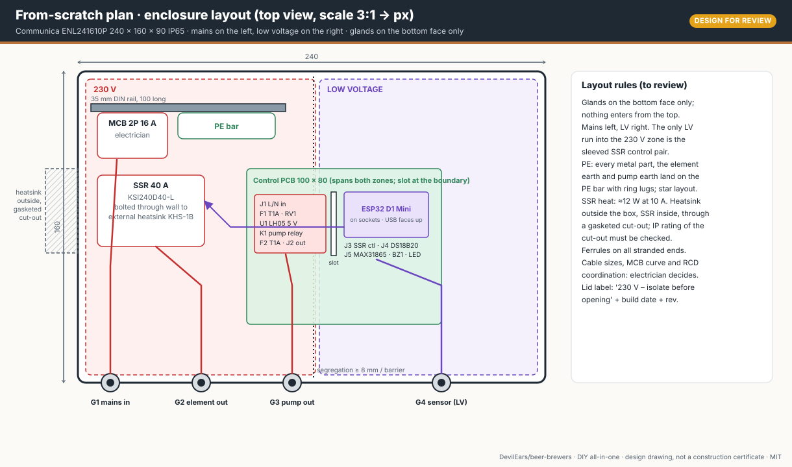
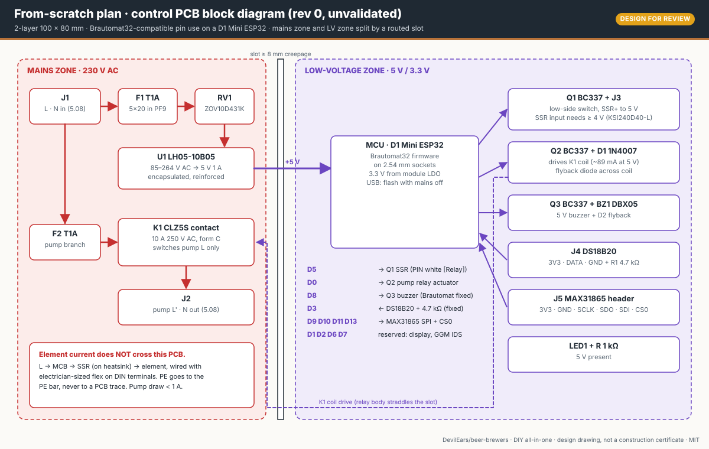

# From-scratch plan: fabricated all-in-one + custom control PCB

     

[← All three plans](../README.md) · [Parts list (`bom.csv`)](bom.csv) · [Shopping list](shopping-list.md)

> [!CAUTION]
> **This is a design to be reviewed. It is not validated hardware.** Nothing here has been built, measured, safety-tested or certified. The control PCB is a rev 0 concept: no board has been laid out, fabricated or powered. A licensed electrician must review the mains design and sign off the finished build before it is used. Anyone with electronics design experience is welcome to review it in a pull request.

> **At a glance.** Start from a plain 35 L stainless kettle. Punch one 32 mm hole for a 2.2 kW weldless element. Roll a malt pipe from perforated stainless sheet around a bought false bottom, and bend your own copper chiller. Then build a **custom ESP32 control PCB** that runs Brautomat32 with the same pin use as the official Brautomat board. You learn the most here and end up with the most open hardware, but it is also the most work and the most risk.

| | |
|---|---|
| **Found-price total** | **R 9,461.56** VAT incl., 27 priced lines, read 24 Nov 2026 (Africa/Johannesburg, SAST) |
| **Still unpriced (5 lines)** | **2.2 kW element (no SA stockist found)**, perforated sheet (quote only), malt-pipe fasteners, MCB/PE bar/flex (electrician), PCB fabrication and small parts. Plus shipping and labour |
| **Batch** | 10–20 L into the fermenter; about 26 L maximum working volume |
| **Power** | 2200 W ≈ 9.6 A at 230 V, plus a 25 W pump |
| **Controller** | Brautomat32 (MIT) on a D1 Mini ESP32 plugged into a custom 2-layer PCB |
| **Effort / time** | High. Roughly 4–6 weekends, plus fabrication lead times and an electrician |
| **Skills** | Sheet-metal work, punching stainless, PCB design in KiCad, soldering, firmware. Mains work stays with the electrician |
| **Risk** | Highest of the three: home-made vessel seals, a home-made PCB and an element mounted by you |

---

## 1. Key specs (design targets)

| Spec | Target | Notes |
|---|---|---|
| Vessel | 35 L 304 SS kettle, Ø 350 × 350 mm, supplied with a 1/2 in weldless tap and a 3 in dial thermometer | [Beyond Brewing](https://beyondbrewing.co.za/product/35l-brew-kettle-tap-thetmometer/), R 2,550, in stock. Shop lists 34 L. **Measure the real inside diameter and wall before cutting** |
| Element | 2200 W, 230 V, 304 SS, weldless, **32 mm hole**, 300 mm long (KegLand KL03506 class) | No SA stockist found; price blank. **Do not** use the 3600 W tri-clamp element sold locally: 15.7 A is too much for a 16 A plug |
| Element height | Centre 50 mm above the outside floor | Below the false bottom, covered by about 8 L of water |
| False bottom | Bought 320 mm perforated disc on 3 × 110 mm M8 legs, 90 mm off the floor | [Beyond Brewing](https://beyondbrewing.co.za/product/320mm-x-25mm-false-bottom-with-raised-feet/) |
| Malt pipe | Perforated 304 SS, 1.0 mm, 2 mm holes, rolled Ø 322 × 240 mm, 25 mm riveted seam | About 19 L grain-bed volume; design grain bill about 4.5–5 kg |
| Top plate | Ø 316 mm perforated disc with a 22 mm return hole | Spreads the return wort |
| Recirculation | 25 W magnetic pump, 13 mm barbs, from the kettle tap through a 1/2 in throttle valve, returning over the rim | [Beyond Brewing](https://beyondbrewing.co.za/product/13mm-barbed-25-watt-high-temperature-magnetic-drive-pump-220-240v/) |
| Chiller | About 10 m of 3/8 in soft copper, Ø 260 mm coil, risers 600 mm | Used after the malt pipe is lifted out |
| Temperature | DS18B20 in a 60 cm lid thermowell. Optional PT100 through a MAX31865 | Matches the Brautomat32 defaults |
| Control box | IP65 polycarbonate, 240 × 160 × 90 mm, four M20 glands, SSR on an external heatsink | [Communica ENL241610P](https://www.communica.co.za/products/enl241610p) |
| Protection | DB ≤ 30 mA earth leakage, in-line 16 A / 30 mA RCD, in-box 16 A 2-pole MCB, T1A fuses on the PCB | Electrician sizes everything |

## 2. System overview

**Brew-day process**

## 3. Mechanical design

### 3.1 Vessel ports

| Port | Function | How | Height (centre above the outside floor) |
|---|---|---|---|
| P1 | Drain and pump suction | Existing 1/2 in weldless tap on the kettle | As supplied (measure) |
| P2 | Element | 32 mm hole, made with a **chassis punch**. Weldless element nut outside, silicone seal inside | 50 mm |
| P3 | Thermowell | Lid, 8 mm hole, 60 cm well with a duotight bulkhead | Probe tip about 110 mm above the floor (in the wort under the pipe) |
| P4 | Return | Silicone hose over the rim, clipped to the top plate. No hole needed | — |

Optional welded route: a 2 in tri-clamp ferrule (R 68, [Beyond Brewing](https://beyondbrewing.co.za/product/2-weld-on-ferrule/)) TIG-welded by a stainless welder at P2. It would take a tri-clamp element if a ≤ 2.4 kW one can be found. A 2 in clamp is R 75 and a gasket R 10. This is not in the total.

### 3.2 Malt pipe

Drawing: [flat patterns + coil](../assets/from-scratch-malt-pipe-pattern.svg).

### 3.3 Cut list

| # | Part | Material | Size (mm) | Qty | Operation |
|---|---|---|---|---:|---|
| C1 | Malt-pipe wall | Perforated 304, 1.0 mm, 2 mm holes | 1035 × 240 | 1 | Laser or shear, then roll to Ø 322 (mean Ø 321) |
| C2 | Top plate | same | Ø 316, Ø 22 centre hole | 1 | Laser or nibble; deburr |
| C3 | False bottom | bought 320 mm disc | Ø 320 | 1 | Check its fit in the rolled pipe; file to size |
| C4 | Legs | M8 A2 threaded rod | 110 | 3 | Two A2 nuts and a dome nut each |
| C5 | Handle | 6 mm 304 round bar | 520 | 1 | Bend a U; hook ends through Ø 6.5 holes |
| C6 | Seam rivets | A2 pop rivets 4.8 mm | grip 2–3 | 12 | Two rows of 6 at 40 mm pitch |
| C7 | False-bottom stops | A2 pop rivets 4.8 mm | — | 3 | 15 mm up from the bottom edge, 120° apart |
| C8 | Chiller coil | 3/8 in soft copper | about 10 m | 1 | 12 turns on a Ø 250 former; 600 mm risers |
| C9 | Hoses | 12.5 × 18.5 silicone | 1200, 1200, 600 | 3 | Tap→pump, pump→valve, valve→return |

### 3.4 Tools

- Chassis (knock-out) punch, **32 mm** (element) and **20.5 mm** (M20 glands). A hole saw in stainless work-hardens and tears; a punch gives a clean, round, sealing edge.
- Cobalt drill bits 4.9 / 6.5 / 8.5 mm, a step drill, cutting oil.
- Pop riveter suitable for stainless rivets, aviation snips, files, a deburring tool.
- Slip-roll, or a hand-rolled former of about Ø 320 (a 50 L drum works) for the malt pipe.
- Tube cutter and a 3/8 in spring bender for the copper.
- Soldering iron, flush cutters, crimper with ferrules, multimeter.
- **Electrician's tools** (not yours): insulation-resistance tester, earth-loop and RCD tester.

### 3.5 Fabrication steps

1. **Measure the kettle.** Record the inside diameter at 50, 100 and 300 mm height, the wall thickness, the base radius, and the tap's height. Update the drawing if anything differs by more than 3 mm.
2. **Mark P2.** It goes 50 mm up, at least 60 mm from the tap, on a flat part of the wall clear of the base radius. Dry-fit the element nut to check it sits flat on the outside.
3. **Punch P2** at 32 mm. Deburr inside and out. Fit the element with its silicone seal, then do a 24-hour water leak test with no power connected.
4. **Malt pipe.** Cut C1. Mark and drill the rivet, leg and handle holes **flat**, before rolling. Roll it, overlap the seam by 25 mm, clamp, then rivet. Fit the false-bottom stops, drop in C3, add the legs and test-fit it in the kettle. It needs at least 8 mm of clearance all round for lifting.
5. **Lid.** Drill 8 mm for the thermowell, fit the bulkhead, and check the well tip clears the malt pipe.
6. **Coil.** Bend C8 (see the lean plan's method). Leak-test it at tap pressure.
7. **Clean everything.** Degrease, rinse, passivate the stainless with a citric acid product, then rinse.
8. **Plumbing.** Pump below the tap, then 1/2 in hose tails, the throttle valve and the return hose. Use a clamp on every barb.

## 4. Control electronics

### 4.1 Enclosure layout

| Item | Position | Notes |
|---|---|---|
| G1–G3 mains glands | Bottom face, left | Mains in, element out, pump out |
| G4 sensor gland | Bottom face, right | DS18B20 / PT100 cable only |
| DIN rail 100 mm | Top left | 16 A 2-pole MCB and PE bar |
| SSR | Left wall | SSR inside; heatsink outside over a gasketed cut-out about 46 × 60 mm (measure the SSR). The cut-out changes the IP rating; review this |
| Control PCB 100 × 80 | Centre right | Straddles the zone boundary; its routed slot lines up with the barrier |
| Lid label | Outside | "230 V – isolate before opening", rev, build date |

### 4.2 PCB block diagram

**Schematic description (rev 0):**

- **Mains entry (J1):** L and N from the in-box MCB. L goes through **F1 (T1A, 5×20)** to **RV1 (430 V MOV)** across L–N and then to **U1 (Mornsun LH05-10B05, 5 V 1 A)**. A second branch goes through **F2 (T1A)** to the **K1 common contact**.
- **Pump output (J2):** K1 NO → pump L′; N passes through. **PE never touches the PCB.** It lands on the PE bar.
- **Isolation:** a routed slot at least 2 mm wide between the mains and LV copper, with a target of **≥ 8 mm creepage and clearance** (reinforced insulation at 230 V). The design must be checked against the relevant standard during review (for example IEC 60335-1 or IEC 62368-1).
- **LV rail:** U1 +5 V feeds the D1 Mini 5 V pin, the K1 coil, SSR+ (J3.1), the buzzer and LED1. The ESP32 module's own regulator gives 3.3 V for the DS18B20 and the MAX31865.
- **SSR drive (Q1):** the KSI240D40-L needs **4–32 V DC**, and an ESP32 GPIO only gives 3.3 V. So J3.1 = +5 V and J3.2 = Q1 collector, with Q1 a BC337 low-side switch: base through 1 kΩ from D5 and 10 kΩ pull-down to GND.
- **Pump relay (Q2):** BC337, base 470 Ω from D0 with a 10 kΩ pull-down. Collector to the K1 coil, D1 1N4007 flyback across the coil. The CLZ5S coil draws about 89 mA at 5 V.
- **Buzzer (Q3):** BC337, base 1 kΩ from D8 with a 10 kΩ pull-down. DBX05 with D2 1N4007 flyback.
- **DS18B20 (J4):** 3V3 / DATA / GND, with R1 4.7 kΩ from DATA to 3V3 on D3, as on the Brautomat board.
- **MAX31865 (J5):** header for the breakout: 3V3, GND, SCLK D9, SDO D10, SDI D11, CS D13.
- **LED1:** 5 V present, through a 1 kΩ resistor.

### 4.3 Pin map (Brautomat32-compatible)

Pin names are the **Brautomat board / D1 Mini labels** used in the Brautomat32 docs, not raw ESP32 GPIO numbers. The heater and pump pins are set in the Brautomat32 web UI, so D5 and D0 are a proposal.

| D-label | Function on this PCB | Fixed or chosen | Source |
|---|---|---|---|
| D3 | DS18B20 one-wire data, 4.7 kΩ pull-up | Fixed on the official board | [The board](https://innuendopi.gitbook.io/brautomat32/plat) |
| D8 | Buzzer (through Q3) | Fixed on the official board | [The board](https://innuendopi.gitbook.io/brautomat32/plat) |
| D9 / D10 / D11 / D13 | MAX31865 SCLK / MISO / MOSI / CS0 | Documented | [Ports](https://innuendopi.gitbook.io/brautomat32/plat/anschluesse) |
| D16 / D17 | MAX31865 CS1 / CS2 | Reserved, not routed | same |
| D1 / D2 | Nextion display TX / RX | Reserved, brought out to a header | same |
| D6 / D7 | GGM IDS command / relay | Reserved, not used | same |
| **D5** | **SSR drive** → set as "PIN white [Relay]" on the kettle | Chosen | [Relay kettle](https://innuendopi.gitbook.io/brautomat32/info-1/relay-kettle) |
| **D0** | **Pump relay** → set as a pump actuator | Chosen | [Actuators](https://innuendopi.gitbook.io/brautomat32/act) |
| 5V / GND | From U1 | — | [Ports](https://innuendopi.gitbook.io/brautomat32/plat/anschluesse) (external 5 V allowed) |

> Before layout, confirm on the real D1 Mini ESP32 (silkscreen and the Brautomat32 firmware pin list) which ESP32 GPIO sits behind D5, D0 and D8. Make sure none is a strapping pin that toggles at boot, such as GPIO 0, 2, 5, 12 or 15. The 10 kΩ pull-downs keep the outputs off during reset, but a boot-strapping clash could stop the board booting.

### 4.4 KiCad-ready netlist table

These tables are meant to be typed into a KiCad schematic. The footprints are suggestions from the standard KiCad libraries. Check each one against the datasheet of the part you actually buy.

**Components**

| Ref | Value / part | Suggested footprint | Zone |
|---|---|---|---|
| J1 | Terminal 5.08 mm 3-way (L, N, spare) | `TerminalBlock_Phoenix:TerminalBlock_Phoenix_MKDS-1,5-3-5.08_1x03_P5.08mm_Horizontal` | Mains |
| J2 | Terminal 5.08 mm 3-way (L′, N, spare) | same | Mains |
| F1, F2 | 5×20 holder PF9 + T1A | Custom footprint from the PF9 datasheet | Mains |
| RV1 | ZOV10D431K | `Varistor:RV_Disc_D12mm_W4.2mm_P7.5mm` (check the pitch) | Mains |
| U1 | Mornsun LH05-10B05 | Custom footprint from the LH05 datasheet | Mains → LV |
| K1 | CLZ5S relay, 5 V, form C | Custom footprint, or `Relay_THT:Relay_SPDT_SANYOU_SRD_Series_Form_C` if the pinout matches | Straddles the slot |
| A1 | D1 Mini ESP32 on sockets | `Module:WEMOS_D1_mini_light` or a custom 2×(10+10) ESP32 D1 Mini footprint | LV |
| Q1–Q3 | BC337-40 | `Package_TO_SOT_THT:TO-92_Inline` | LV |
| D1, D2 | 1N4007 | `Diode_THT:D_DO-41_SOD81_P10.16mm_Horizontal` | LV |
| R1 | 4.7 kΩ | `Resistor_THT:R_Axial_DIN0207_L6.3mm_D2.5mm_P10.16mm_Horizontal` | LV |
| R2, R4, R9 | 1 kΩ | same | LV |
| R3 | 470 Ω | same | LV |
| R6–R8 | 10 kΩ | same | LV |
| BZ1 | DBX05 | Custom (12 mm, 6.5 mm pitch) | LV |
| LED1 | 3 mm green | `LED_THT:LED_D3.0mm` | LV |
| J3 | Terminal 5.08 mm 2-way (SSR+, SSR−) | `TerminalBlock_Phoenix:TerminalBlock_Phoenix_MKDS-1,5-2-5.08_1x02_P5.08mm_Horizontal` | LV |
| J4 | Terminal 3-way (3V3, DATA, GND) | 3.5 or 5.08 mm 3-way | LV |
| J5 | 1×6 pin header for the MAX31865 | `Connector_PinHeader_2.54mm:PinHeader_1x06_P2.54mm_Vertical` | LV |
| J6 | 1×4 header: D1, D2, 5V, GND (display, reserved) | `Connector_PinHeader_2.54mm:PinHeader_1x04_P2.54mm_Vertical` | LV |

**Nets**

| Net | Nodes |
|---|---|
| AC_L_IN | J1.1, F1.1, F2.1 |
| AC_L_F1 | F1.2, RV1.1, U1.AC_L |
| AC_N | J1.2, RV1.2, U1.AC_N, J2.2 |
| PUMP_L_F2 | F2.2, K1.COM |
| PUMP_L_SW | K1.NO, J2.1 |
| (no connect) | K1.NC, J1.3, J2.3 |
| +5V | U1.+VO, A1.5V, K1.COIL1, D1.K, J3.1, BZ1.+, D2.K, R9.1, J6.3 |
| GND | U1.−VO, A1.GND, Q1.E, Q2.E, Q3.E, R6.2, R7.2, R8.2, J4.3, J5.2, LED1.K, J6.4 |
| +3V3 | A1.3V3, R1.1, J4.1, J5.1 |
| OW_DATA | A1.D3, R1.2, J4.2 |
| SSR_GPIO | A1.D5, R2.1 |
| Q1_B | R2.2, R6.1, Q1.B |
| SSR_NEG | Q1.C, J3.2 |
| PUMP_GPIO | A1.D0, R3.1 |
| Q2_B | R3.2, R7.1, Q2.B |
| K1_COIL_LO | Q2.C, K1.COIL2, D1.A |
| BUZ_GPIO | A1.D8, R4.1 |
| Q3_B | R4.2, R8.1, Q3.B |
| BUZ_LO | Q3.C, BZ1.−, D2.A |
| SPI_SCLK | A1.D9, J5.3 |
| SPI_MISO | A1.D10, J5.4 |
| SPI_MOSI | A1.D11, J5.5 |
| SPI_CS0 | A1.D13, J5.6 |
| LED_A | R9.2, LED1.A |
| UART_TX / UART_RX | A1.D1, J6.1 / A1.D2, J6.2 |

**PCB rules (rev 0 targets, to review):** 2 layers, 1.6 mm FR-4, 2 oz copper. Mains traces at least 2.5 mm wide (pump branch below 1 A). Routed slot under K1 and U1 at the zone boundary. No LV copper within 8 mm of mains copper on either layer. Mounting holes in the LV zone only, with nylon standoffs. No ground pour in the mains zone.

### 4.5 Element and pump wiring (off the PCB)

- L from the MCB to SSR terminal 1. SSR terminal 2 to the element L. Element N back to the MCB N. The element earth and the kettle body go to the PE bar.
- The conductor size, ferrules and terminals are the electrician's choice (expect at least 1.5 mm² for the element circuit).
- The SSR control pair (J3 → SSR 3/4) is LV. Sleeve it where it passes through the 230 V zone.

## 5. Electrical safety (South Africa, 230 V / 50 Hz)

> [!WARNING]
> Mains electricity, water and steel pots together can kill. This page is a design note to discuss with a **licensed electrician**. It is not a wiring certificate, a Certificate of Compliance (CoC) or a product approval.

**Standards and who does what**

- **SANS 10142-1** covers premises wiring: the distribution board, socket circuits and earth leakage. It does not certify a home-made appliance. If any fixed wiring changes, a registered electrician must issue a **CoC**.
- A general-purpose South African socket is **SANS 164-1, 16 A, 250 V~** ([SAFEhouse sockets guide](https://safehousesa.co.za/guide-sockets/)).
- Socket outlets must be protected by earth leakage with a tripping current of **30 mA** ([SAFEhouse](https://safehousesa.co.za/guide-sockets/)). A summary of **SANS 10142-1:2026 (Edition 3.3)** says new socket circuits need **non-auto-reclosing** earth leakage of **≤ 30 mA** ([Elite Energy](https://www.eliteenergy.co.za/blog/articles/stove-circuit-earth-leakage-sans-10142-1.html), citing clause 6.7.5). Check the current SABS text.

**RCD: two layers**

1. The distribution-board earth-leakage unit must work on the socket you brew on. Press its test button before brew day.
2. Every plan adds an **in-line 16 A / 30 mA RCD** (RS PRO, R 964.10 inc VAT, [RS](https://za.rs-online.com/web/p/rcd-plugs/2818923/)). A licensed electrician terminates it with a SANS 164-1 plug and lead. It is an **extra** layer and does not replace the DB device. No South African 3-pin plug-in 30 mA adaptor with a confirmed price was found. Schuko (Type F) PRCDs do not fit a SANS 164-1 socket.

**Load on one 16 A plug**

- At 230 V: 2400 W ≈ **10.4 A**, 2200 W ≈ **9.6 A**. Pumps add well under 1 A. That leaves headroom on 16 A. **Never** fit a 3 kW or 3.6 kW element on this plug (13–15.7 A continuous).
- Use one dedicated socket. No multi-plug adaptors sharing the kettle with other heavy loads.

**Earthing**

- Protective earth (green/yellow) must run unbroken from the plug's earth pin to the **kettle body**, the **element earth**, the **pump** and any **metal enclosure parts**. Never cut or bypass the earth pin.
- An electrician should check earth continuity and insulation resistance before first use and after any change.

**Water, heat and switching**

- **Never dry-fire** an element. It must be covered before power is applied.
- Pumps must be **primed** and must **not run dry**.
- Keep the control box and plugs above and away from the kettle, the tap and steam. Dry floor, dry hands.
- An SSR switching about 10 A gives off roughly 12 W of heat. It needs a proper heatsink with somewhere for the heat to go.
- If an RCD trips more than once: **stop**, unplug, and have the system checked. Never reset and carry on.

**Electrician sign-off is required before** any mains wiring you have built is powered, any element is mounted or rewired, or a new socket or circuit is added.

## 6. Test plan

Run the tests in order. Do not move on to the next stage until every test in the current one passes.

| Stage | # | Test | Pass when | Who |
|---|---|---|---|---|
| Bench, LV only | B1 | Bare PCB: continuity and shorts; check the slot's creepage with calipers | No shorts; ≥ 8 mm everywhere between the zones | You |
| | B2 | Power the LV side from a bench 5 V supply (no mains). Flash Brautomat32 | Web UI loads; DS18B20 reads room temperature | You |
| | B3 | Toggle D5 / D0 / D8 from the UI | SSR LED, K1 click and buzzer each respond only to their own pin | You |
| | B4 | Reset and power-cycle 10 times | Nothing switches on during boot (watch the SSR LED and K1) | You |
| | B5 | Measure the SSR control voltage at J3 when on | ≥ 4 V | You |
| Mains, no load | M1 | Electrician inspects the box, terminations and glands | Signed off | Electrician |
| | M2 | Earth continuity: plug PE pin to kettle, element sheath, pump and heatsink | Low, consistent readings | Electrician |
| | M3 | Insulation resistance, L+N to PE | Within the electrician's limit | Electrician |
| | M4 | RCD trip tests (DB and in-line) | Both trip within their rated time | Electrician |
| Water | W1 | 24 h leak test at P2 and the tap, no power | Dry | You |
| | W2 | 25 L water, heat to 65 °C at full power, then AutoTune ([relay kettle](https://innuendopi.gitbook.io/brautomat32/info-1/relay-kettle)) | Plausible readings; the heater switches off from the UI | You + supervisor |
| | W3 | Hold 65 °C for 60 min with recirculation | ±0.5 °C; no trips | You |
| | W4 | Boil 30 min, then check the heatsink and SSR temperatures | Heatsink below about 70 °C (review against the KSI datasheet) | You |
| | W5 | Lift the malt pipe when full of wet grain (use spent grain or water-soaked oats) | Seam, rivets and handle hold; nothing deforms | You |
| | W6 | Coil chill of 20 L | Note the time to 25 °C and the water used | You |
| Brew | X1 | First brew, 15 L, ≤ 4 kg grain | Uneventful | You |

## 7. Bill of materials

Full rows are in [`bom.csv`](bom.csv) and grouped by shop in [`shopping-list.md`](shopping-list.md).

| Group | Found prices (inc VAT) |
|---|---:|
| Kettle, false bottom, thermowell, pump, valve, hose tails, hose, clamps (Beyond Brewing) | R 5,733.00 |
| 3/8 in × 15 m copper (Alcell) | R 849.00 |
| Enclosure, glands, SSR, heatsink, PSU, ESP32, MAX31865, relay and small parts (Communica) | R 1,745.26 |
| DS18B20 kit (Micro Robotics) | R 170.20 |
| In-line RCD (RS) | R 964.10 |
| **From-scratch total (found prices)** | **R 9,461.56** |

Communica's catalogue feed shows prices **ex VAT**. The inc-VAT figures are ex × 1.15, checked against the D1 Mini product page (R 117.39 ex, R 135.00 inc).

The found-price total looks lower than the comfortable plan's, but it is **missing the element**, the perforated sheet, PCB fabrication and the electrician's parts. Expect the real total to land close to the comfortable plan.

## 8. Unverified points and open design questions

- **Element:** no SA stockist was found for a 2.2–2.4 kW weldless element. The design assumes KegLand KL03506 (32 mm hole, 300 mm long). Ask Beyond Brewing, which is a KegLand distributor. A local 2 kW geyser "boss" element (V-Tech, R 229.99 at [U-Build](https://u-build.co.za/shop/u-build/plumbing/geysers-water-heating/v-tech-element-boss-typ-2kw/), in stock) was found, but its sheath material, thread and watt density were not checked, so it is **not recommended** until someone does.
- **Kettle dimensions** are shop figures (35 × 35 cm, 34 L). The real inside diameter, wall thickness and tap height must be measured.
- **Malt-pipe clearance** of about 11 mm per side is tight for lifting. Grain-bed volume and the grain-bill limit are calculated, not tested.
- **Element centre at 50 mm** depends on the base radius and nut size of the element actually bought.
- **PCB:** rev 0 concept only. Nothing has been laid out or powered. The footprints, CLZ5S pinout, LH05 footprint, creepage targets and standard references all need review.
- **GPIO mapping** of D0, D5 and D8 on the BMT D1 Mini ESP32 and the Brautomat32 firmware is not confirmed, and neither is the strapping-pin behaviour.
- **SSR heat** on an external heatsink through a gasketed cut-out: the thermal and IP performance is not verified.
- **RS RCD** price is from the comfortable pass on the same day and is marked indicative. The DS18B20 kit price is also from that pass.
- **Perforated sheet** and fasteners are quote-only and unpriced.
- Stock and prices will change.

## 9. Sources

- Brautomat32: [board](https://innuendopi.gitbook.io/brautomat32/plat), [ports](https://innuendopi.gitbook.io/brautomat32/plat/anschluesse), [relay kettle](https://innuendopi.gitbook.io/brautomat32/info-1/relay-kettle), [actuators](https://innuendopi.gitbook.io/brautomat32/act), [hardware](https://innuendopi.gitbook.io/brautomat32/hw), [GitHub](https://github.com/InnuendoPi/Brautomat32)
- Element reference: [KegLand KL03506](https://kegland.com.au/products/2200-watt-weld-less-heating-element), [KegLand EU](https://kegland.eu/products/2200-watt-stainless-steel-heating-element-220-240v)
- Locally sold 3600 W 2 in tri-clamp element (rejected, too much current for 16 A): [Beyond Brewing](https://beyondbrewing.co.za/product/3600-watt-stainless-steel-heating-element-with-2inch-tri-clover-220-240v/)
- Perforated sheet: [Kentech](https://kentech.co.za/perforated-metal-plate-supplier-in-south-africa/), [Allied Mesh](https://www.alliedmesh.co.za/stainless-stock.html)
- Electronics: Communica product pages linked in [`bom.csv`](bom.csv)
- Safety: [SAFEhouse](https://safehousesa.co.za/guide-sockets/), [Elite Energy on SANS 10142-1](https://www.eliteenergy.co.za/blog/articles/stove-circuit-earth-leakage-sans-10142-1.html), [RS PRO in-line RCD](https://za.rs-online.com/web/p/rcd-plugs/2818923/)
