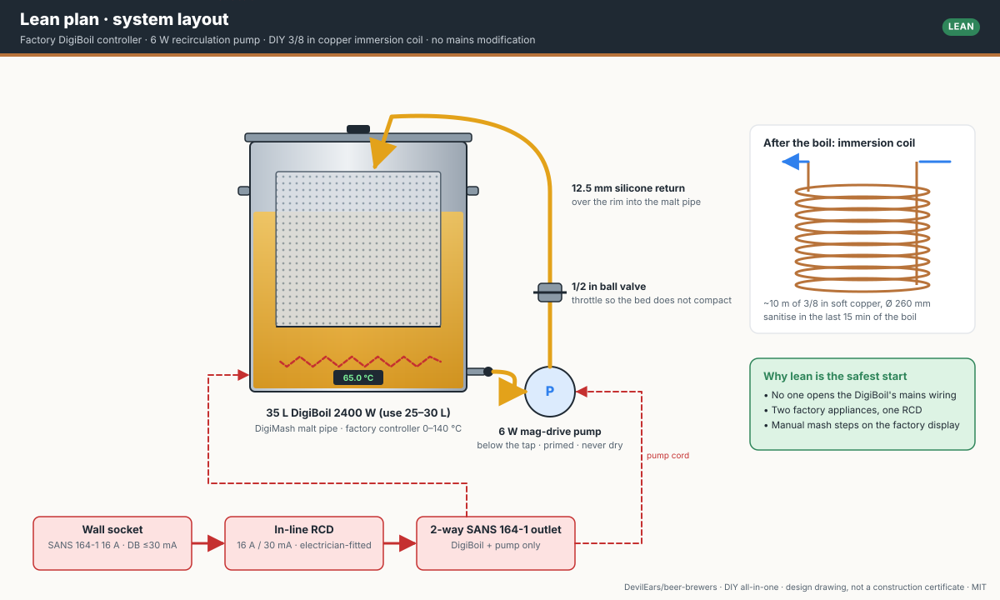
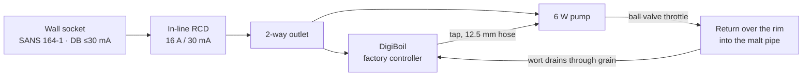
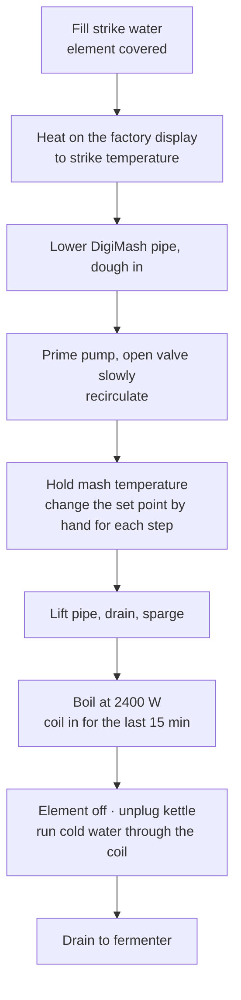

# Lean plan: stock-controller all-in-one

     

[← All three plans](../README.md) · [Parts list (`bom.csv`)](bom.csv) · [Shopping list](shopping-list.md)

> **At a glance.** The cheapest and safest way to start. Use the DigiBoil's **own digital controller**, add the DigiMash malt pipe and a 6 W pump for recirculation, and bend a copper immersion chiller yourself. **Nobody opens the kettle's mains wiring.** You set each mash step by hand on the factory display. Brautomat32 can be added later by moving up to the comfortable plan.

| | |
|---|---|
| **Found-price total** | **R 9,255.10** VAT incl., 8 priced lines, re-checked 24 Nov 2026 (Africa/Johannesburg, SAST) |
| **Still unpriced** | Chiller water hose and tap connector; SANS 164-1 plug, flex and 2-way outlet for the RCD; shipping |
| **Batch** | 10–20 L into the fermenter; kettle used at 25–30 L |
| **Power** | 2400 W (500 / 1900 / 2400 W selectable), about 10.4 A at 230 V, plus a 6 W pump |
| **Controller** | DigiBoil factory controller, 0–140 °C, manual steps |
| **Chiller** | DIY coil from 15 m of 3/8 in soft copper; the 14 m SS immersion chiller is out of stock |
| **Effort / time** | Low. One weekend: an afternoon of hose and coil work, then a water day |
| **Skills** | Hose clamps, bending soft copper, careful cleaning. The electrician only makes up the RCD lead |
| **Make vs buy** | A BrewZilla 35 L Gen 4.1 with a free immersion chiller was R 11,150 on the same day, so lean saves about R 1,900 |

---

## 1. Key specs

| Spec | Value | Source |
|---|---|---|
| Kettle | 35 L DigiBoil, 304 SS, brim-full 35 L, work at 25–30 L | [Beyond Brewing](https://beyondbrewing.co.za/product/35l-digiboil-digital-turbo-boiler-2400watt/) |
| Element | Concealed, 500 / 1900 / 2400 W; shop states 240 V / 10 A | same |
| Controller | Built-in digital, 0–140 °C; no automatic mash steps | same |
| Malt pipe | DigiMash kit: false bottom, pipe, bottom screen, handle; max grain bill 8 kg (shop) | [Beyond Brewing](https://beyondbrewing.co.za/product/digimash-upgrade-kit-for-35l-digiboil/) |
| Pump | 6 W magnetic drive, 12 L/min at 240 V, 2.1 m head, 120 °C, 14 mm OD barbs | [Beyond Brewing](https://beyondbrewing.co.za/product/6-watt-magnetic-drive-pump-for-brewzilla/) |
| Chiller | DIY coil: about 10 m of 9.52 mm OD soft copper, Ø 260 mm, risers 600 mm above the rim | [Alcell](https://alcell.co.za/products/alaska-copper-pipe-3-8o-dx15m-coil) |
| Hose | 12.5 mm ID × 18.5 mm OD food-grade silicone, 6 m | [Beyond Brewing](https://beyondbrewing.co.za/product/6m-roll-of-heavy-duty-silicone-tube-12-5mm-id-x-18-5mm-od/) |
| Protection | In-line 16 A / 30 mA RCD after a ≤ 30 mA DB earth-leakage circuit | [RS](https://za.rs-online.com/web/p/rcd-plugs/2818923/) |

## 2. How it works

**Brew day with manual steps**

## 3. Chiller: replacing the out-of-stock immersion chiller

The 14 m stainless immersion chiller from the first brief (R 1,590) was **still out of stock** on 24 Nov 2026. BeerLab's 6-coil copper chiller (R 1,250) was **sold out** too. The lean plan bends its own coil instead:

| Option | Price (inc VAT) | Stock 24 Nov 2026 | Verdict |
|---|---:|---|---|
| **DIY coil from Alaska 3/8 in × 15 m soft copper** ([Alcell](https://alcell.co.za/products/alaska-copper-pipe-3-8o-dx15m-coil)) | **849.00** | In stock | **Chosen.** Cheapest. Wall thickness not stated |
| DIY coil from JASA-COP 3/8 in × 15 m, 0.71 mm wall, nitrogen-purged ([Xtreme Group](https://xtremegroup.info/product/jasa-cop-3-8-15-3-8-copper-tube-15m-0-71mm/)) | 1,199.00 | In stock | Good alternative: wall stated, factory-cleaned |
| Plate wort chiller ([Brewcraft](https://www.brewcraft.co.za/products/plate-worth-chiller)) | 1,550.00 | Available | Works with the pump, but needs a hop filter and hard cleaning |
| 14 m 304 SS immersion chiller ([Beyond Brewing](https://beyondbrewing.co.za/product/immersion-chiller-14m-long-stainless-steel/)) | 1,590.00 | Out of stock | Original choice; wait if you prefer stainless |
| BeerLab 6-coil copper ([BeerLab](https://www.beerlab.co.za/products/immersion-chiller)) | 1,250.00 | Sold out | — |

**How to make the coil** (same drawing as the from-scratch plan, [flat patterns + coil](../assets/from-scratch-malt-pipe-pattern.svg)):

1. Uncoil slowly. Leave 600 mm straight for the inlet riser.
2. Wrap about 12 turns around a Ø 250 mm former, such as a paint tin or a short length of PVC pipe, keeping the turns slightly apart.
3. Bring the outlet back up the outside of the coil. Use a spring bender where it turns up, so it does not kink.
4. Cut to length with a tube cutter and deburr.
5. Clean it: hot water and brewery cleaner through and over, rinse, then a short citric or vinegar soak to brighten the copper. Rinse well. Do not store it wet with acid in it.
6. Water side: push 3/8 in ID vinyl or silicone hose over both ends, add hose clamps and fit a garden-tap connector. Tap pressure only.

## 4. Bill of materials

Full rows, sources and notes are in [`bom.csv`](bom.csv). The shopping list grouped by shop is in [`shopping-list.md`](shopping-list.md).

| Group | Found prices (inc VAT) |
|---|---:|
| Kettle + DigiMash + 6 W pump + hose + valve + clamps (Beyond Brewing) | R 7,442.00 |
| 3/8 in × 15 m copper for the coil (Alcell) | R 849.00 |
| In-line 16 A / 30 mA RCD (RS) | R 964.10 |
| **Lean total** | **R 9,255.10** |

## 5. Build steps

1. **Unpack and inspect.** Check the DigiBoil cord, plug and earth pin. Check the tap washer and that the lid fits.
2. **Electrician makes up the RCD lead.** SANS 164-1 plug, 3-core flex, the RS in-line RCD, and a 2-way SANS 164-1 outlet for the kettle and pump. This is the only mains work in the lean plan.
3. **Water test on the factory controller.** Fill to 25 L so the element is covered. Heat to 65 °C, then to the boil. Watch for leaks and nuisance trips. Press the RCD test button. It must trip.
4. **Fit the DigiMash.** Put the false bottom and screen in place, then fit the pipe and handle.
5. **Plumb the pump.** Run 12.5 mm silicone from the kettle tap down to the pump inlet. The pump must sit **below** the tap. Then run from the pump outlet to the ball valve and up and over the rim into the malt pipe. Fit stepless clamps on every barb.
6. **Prime and recirculate water.** Open the kettle tap, let water flood the pump, then switch the pump on. Open the throttle valve slowly. The pump must never run dry.
7. **Make the chiller coil** (section 3) and test it with tap water in a bucket for leaks.
8. **Wet rehearsal.** Run a full water "brew": mash temperature hold, a 60-minute boil, coil in for the last 15 minutes, then chill. Note the times and the litres lost to the boil.
9. **First brew.** A simple 15–20 L recipe well inside the 8 kg malt-pipe limit.

## 6. Test plan

| # | Test | Pass when |
|---|---|---|
| T1 | DB earth leakage test button | DB device trips and resets |
| T2 | In-line RCD test button | Trips. Repeat each brew day |
| T3 | Water to 25 L, heat to 65 °C on the factory controller | Holds within ±1 °C of the set point for 15 min. Note the overshoot |
| T4 | Heat to the boil at 2400 W | Rolling boil; no trips, smells or leaks |
| T5 | Pump primed, recirculate 30 min at 65 °C | Steady flow; no air locks; valve throttles smoothly |
| T6 | Coil pressure check in a bucket at tap pressure | No bubbles or drips |
| T7 | Chill 20 L from boiling | Note the time to 25 °C and the water used |
| T8 | Unplug test | Both plugs can be reached and pulled without reaching over the kettle |

## Electrical safety (South Africa, 230 V / 50 Hz)

> [!WARNING]
> Mains electricity, water and steel pots together can kill. This page is a design note to discuss with a **licensed electrician**. It is not a wiring certificate, a Certificate of Compliance (CoC) or a product approval.

**Standards and who does what**

- **SANS 10142-1** covers premises wiring: the distribution board, socket circuits and earth leakage. It does not certify a home-made appliance. If any fixed wiring changes, a registered electrician must issue a **CoC**.
- A general-purpose South African socket is **SANS 164-1, 16 A, 250 V~** ([SAFEhouse sockets guide](https://safehousesa.co.za/guide-sockets/)).
- Socket outlets must be protected by earth leakage with a tripping current of **30 mA** ([SAFEhouse](https://safehousesa.co.za/guide-sockets/)). A summary of **SANS 10142-1:2026 (Edition 3.3)** says new socket circuits need **non-auto-reclosing** earth leakage of **≤ 30 mA** ([Elite Energy](https://www.eliteenergy.co.za/blog/articles/stove-circuit-earth-leakage-sans-10142-1.html), citing clause 6.7.5). Check the current SABS text.

**RCD: two layers**

1. The distribution-board earth-leakage unit must work on the socket you brew on. Press its test button before brew day.
2. Every plan adds an **in-line 16 A / 30 mA RCD** (RS PRO, R 964.10 inc VAT, [RS](https://za.rs-online.com/web/p/rcd-plugs/2818923/)). A licensed electrician terminates it with a SANS 164-1 plug and lead. It is an **extra** layer and does not replace the DB device. No South African 3-pin plug-in 30 mA adaptor with a confirmed price was found. Schuko (Type F) PRCDs do not fit a SANS 164-1 socket.

**Load on one 16 A plug**

- At 230 V: 2400 W ≈ **10.4 A**, 2200 W ≈ **9.6 A**. Pumps add well under 1 A. That leaves headroom on 16 A. **Never** fit a 3 kW or 3.6 kW element on this plug (13–15.7 A continuous).
- Use one dedicated socket. No multi-plug adaptors sharing the kettle with other heavy loads.

**Earthing**

- Protective earth (green/yellow) must run unbroken from the plug's earth pin to the **kettle body**, the **element earth**, the **pump** and any **metal enclosure parts**. Never cut or bypass the earth pin.
- An electrician should check earth continuity and insulation resistance before first use and after any change.

**Water, heat and switching**

- **Never dry-fire** an element. It must be covered before power is applied.
- Pumps must be **primed** and must **not run dry**.
- Keep the control box and plugs above and away from the kettle, the tap and steam. Dry floor, dry hands.
- An SSR switching about 10 A gives off roughly 12 W of heat. It needs a proper heatsink with somewhere for the heat to go.
- If an RCD trips more than once: **stop**, unplug, and have the system checked. Never reset and carry on.

**Electrician sign-off is required before** any mains wiring you have built is powered, any element is mounted or rewired, or a new socket or circuit is added.

## 7. Pre-brew checklist

- [ ] DB earth leakage and in-line RCD both tested today.
- [ ] Plugs and RCD on a dry surface, above floor level, away from the tap and steam.
- [ ] Element covered with water before switching on. Never dry-fire.
- [ ] Pump primed and below the tap. Never run it dry.
- [ ] Clamps on every barb. Hoses not kinked or touching the hot kettle wall where it could scald.
- [ ] Coil water hose on tap pressure only, with the outlet going to a drain.
- [ ] Someone else knows how to cut the power.

## 8. Unverified points

- Alcell does not state the copper wall thickness, and the search snippet said only 4 coils were left.
- The 6 W pump has 14 mm OD barbs, used with 12.5 mm ID hose and 16–18 mm stepless clamps. That fit has not been tried by hand.
- The RS RCD price is the comfortable-plan reading from the same day. RS blocks scripted page reads, so it was not re-read, and RS marks the price as indicative.
- The DigiBoil factory controller's hold accuracy and overshoot with the malt pipe fitted are not published. T3 and T5 measure them.
- The plate chiller's plate count and fittings are not stated on the Brewcraft page.
- Stock and prices will change.

## 9. Sources

- Beyond Brewing product pages linked in [`bom.csv`](bom.csv), schema.org offers read 24 Nov 2026.
- Copper: [Alcell](https://alcell.co.za/products/alaska-copper-pipe-3-8o-dx15m-coil), [Xtreme Group](https://xtremegroup.info/product/jasa-cop-3-8-15-3-8-copper-tube-15m-0-71mm/), [Velocity Air](https://www.velocityair.co.za/product/copper-pipping-3-8-inch-x-15m/) (R 950, in stock).
- Chillers: [Brewcraft plate chiller](https://www.brewcraft.co.za/products/plate-worth-chiller), [BeerLab](https://www.beerlab.co.za/products/immersion-chiller).
- Safety: [SAFEhouse](https://safehousesa.co.za/guide-sockets/), [Elite Energy on SANS 10142-1](https://www.eliteenergy.co.za/blog/articles/stove-circuit-earth-leakage-sans-10142-1.html), [RS PRO in-line RCD](https://za.rs-online.com/web/p/rcd-plugs/2818923/).
